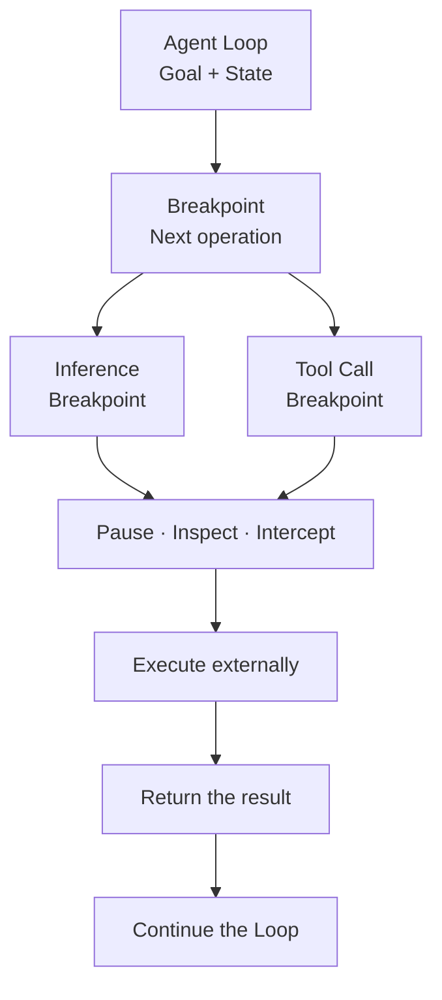
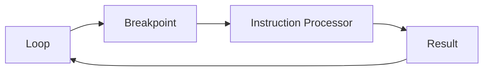

# Mozaik Agent

### An Interruptible Agent Harness.

An agent harness that brings debugger-like execution control to AI agents. **Set breakpoints, pause, intercept, and resume inference and tool execution at runtime.**

[](LICENSE)
[](https://www.typescriptlang.org/)

---

## Why Mozaik Agent?

We have always been able to pause a program at a breakpoint, inspect its state, and decide when to continue. Why should AI agents be different?

An AI agent runs in a loop: it asks a model what to do, executes tools, feeds results back, and repeats. In many agent frameworks, those steps are hidden inside a single execution call. To intervene, developers must work around the loop rather than work with it.

**Mozaik Agent makes execution boundaries explicit.** Before inference or a tool call runs, the Loop exposes the next operation and waits for its result. Your application decides **when, where, how, and whether** to execute it.

This makes interruption a property of the agent's execution model—not an afterthought.

## How it works



A breakpoint identifies an instruction boundary. It does not imply that a debugger UI is attached or that execution must remain paused indefinitely. It gives the surrounding application an opportunity to intervene before the next step runs.

## Core capabilities

### Breakpoints as first-class concepts

Every inference and tool call has a clear boundary between **deciding what to do** and **executing it**.

- **Inference breakpoint** — the next model inference is ready to be processed.
- **Tool-call breakpoint** — a requested tool and its arguments are ready to be processed.

Because the operation is explicit, your application can inspect it, approve it, route it to another executor, or decline to run it.

### Pause, continue, and stop

Use the same mental model you already know from program execution:

| Action        | Meaning                                                |
| ------------- | ------------------------------------------------------ |
| **Pause**     | Hold execution at the current operation boundary.      |
| **Inspect**   | Examine the pending operation and the Loop's context.  |
| **Intercept** | Apply application logic before an operation executes.  |
| **Continue**  | Supply the operation's result so the Loop can advance. |
| **Stop**      | End the Loop without executing the pending operation.  |

A pause is not a restart. The Loop retains the goal, context, completed operations, and pending operation.

### Separate the Loop from execution

**The Loop determines what should happen next. Your application determines how it happens.**

The Loop manages its own progression and state. Inference providers, tool executors, approvals, and external services can remain outside that core. That separation allows you to adapt execution policies without rewriting the agent's decision-making loop.

### Human-in-the-loop by design

A destructive tool call should not execute just because the model requested it.

At a tool-call breakpoint, you can review the tool name and arguments, ask a person to approve the action, and continue only after the decision is made. The same boundary can be used for policy checks, auditing, or custom routing.

### Handoff without losing the work

A Loop has a goal, context, an assignee, completed operations, and potentially a pending operation. Handoff changes who is responsible for moving that Loop forward.

A person, another agent, or another service can take over while preserving the work already done. The receiving party continues from the current boundary instead of starting the goal again.

## The Loop

The **Loop** represents one execution toward a goal. It retains:

| Concept                            | Responsibility                               |
| ---------------------------------- | -------------------------------------------- |
| **Goal**                           | What the agent is working toward.            |
| **Assignee**                       | Who is responsible for advancing the Loop.   |
| **Context**                        | The information available to the agent.      |
| **Breakpoint / pending operation** | What the Loop is waiting to process next.    |
| **Completed operations**           | The operations and results already recorded. |

A typical run looks like this:

```text
1. Start with a goal
2. Reach an inference breakpoint
3. Execute inference and return the result
4. Reach a tool-call breakpoint
5. Inspect or approve the tool call
6. Execute the tool and return its result
7. Continue to the next inference breakpoint
8. Complete the goal, or stop execution
```

The important detail is that the Loop advances **one operation at a time**. Each operation becomes visible before it is processed.

## Breakpoints

The following TypeScript illustrates the **domain model**, not a guaranteed copy-paste API from the published package:

```ts
// Conceptual model

type LoopBreakpoint =
	| {
			type: "inference"
			parameters: InferenceParameters
	  }
	| {
			type: "tool_call"
			parameters: ToolCallParameters
	  }
```

The Loop exposes the next breakpoint. An external instruction processor performs the corresponding operation and provides a result. The Loop then records that result and determines its next step.



This separation is also useful when different instructions have different execution requirements—for example, model inference through a provider SDK, a tool call in a sandbox, or an operation requiring human approval.

## Example: approving a tool call

Imagine an agent working on a coding task. It decides to execute a shell command that modifies files.

Without an explicit execution boundary, a framework may immediately dispatch the command. With Mozaik Agent, the tool call becomes a pending operation:

```text
Goal: Update the project dependencies

Breakpoint: Tool Call
Tool: shell
Arguments: { "command": "npm install" }

Application decision: Review required
Status: Paused
```

A developer reviews the operation and approves it. The application executes the tool, supplies the output, and the Loop continues with the updated context.

The breakpoint is not just a debugging feature. It is a **programmable decision point** in the agent's execution.

## Use cases

**Approval workflows.** Require confirmation before running sensitive tools or making consequential changes.

**Debugging and inspection.** Inspect what the agent is about to do, along with the context that led to that decision.

**Custom execution environments.** Process instructions through your preferred model providers, sandboxes, tools, or services.

**Agent handoffs.** Transfer responsibility for a Loop while retaining its pending operation and prior work.

**Execution policies.** Apply rules at instruction boundaries instead of embedding every rule inside tool implementations.

## Design philosophy

### The agent loop is a stateful process

An agent should be able to carry its goal, context, and execution progress from one instruction to the next. A tool call is not an opaque side effect; it is a step in that process.

### Instructions should be observable before execution

The system should know _what_ is about to execute before choosing _how_ to execute it. This is the foundation for breakpoints, approvals, routing, and interception.

### Execution control belongs to the application

A harness should not force every developer into one execution policy. Some operations can run automatically. Others may require approval, different infrastructure, or a handoff.

### Interruption should preserve context

Pausing an agent should preserve its progress. Continuing should advance from the pending operation rather than reconstructing the entire task.

## Mozaik ecosystem

Mozaik Agent is one part of the broader Mozaik project:

- **[Mozaik Agent](https://github.com/jigjoy-ai/mozaik-agent)** — an interruptible agent harness for individual agent execution.
- **[Mozaik Network](https://github.com/jigjoy-ai/mozaik-network)** — communication infrastructure for connecting agents across machines.
- **Mozaik Cloud** — tooling for observing and managing agent systems.

Together, these components aim to make agent execution more understandable, adaptable, and collaborative.

## Contributing

Contributions, ideas, and bug reports are welcome. Read the [Contributing Guidelines](CONTRIBUTING.md), open an [issue](https://github.com/jigjoy-ai/mozaik-agent/issues), or submit a pull request.

If this approach to agent execution resonates with you, consider [starring the repository](https://github.com/jigjoy-ai/mozaik-agent).

## License

MIT. See [LICENSE](LICENSE).

Built by [JigJoy](https://jigjoy.ai).
